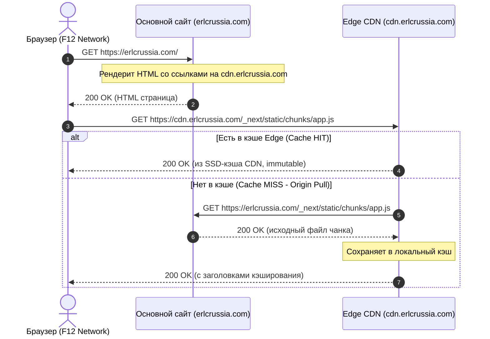

В этом руководстве подробно описано, как настроить проект Next.js (`ERLC-Russia-Site`) для автоматической загрузки всех статических ресурсов (JavaScript-чанков, CSS-файлов, шрифтов и медиа) с собственного CDN (`cdn.erlcrussia.com`).

В результате основной сервер (`erlcrussia.com`) отдаёт исключительно начальный HTML и динамические API-запросы, а все ресурсы папки `_next/static` загружаются с CDN. В консоли разработчика браузера (F12, вкладка Network) запросы к папке `_next` на домене `erlcrussia.com` полностью отсутствуют.

---

## Архитектура и Принцип Работы

Когда пользователь открывает страницу сайта на Next.js:
1. Браузер запрашивает HTML-документ у основного сервера: `GET https://erlcrussia.com/ru`.
2. Сервер возвращает сгенерированный HTML (SSR). Внутри HTML находятся теги `<script>`, `<link rel="stylesheet">` и предзагрузки шрифтов.
3. По умолчанию путь к чанкам выглядит как `/_next/static/chunks/main-app.js`. Но при настройке **`assetPrefix`** Next.js автоматически подставляет домен CDN:
   ```html
   <script src="https://cdn.erlcrussia.com/_next/static/chunks/fd9301ba-a764d2.js" defer=""></script>
   <link rel="stylesheet" href="https://cdn.erlcrussia.com/_next/static/css/81a9f5c401.css" />
   ```
4. Браузер начинает параллельно загружать скрипты и стили с `cdn.erlcrussia.com`, снимая сетевую нагрузку и нагрузку на диск с основного Node.js-сервера.



---

## Способы Доставки Чанков в CDN

Существует два надёжных подхода к организации работы CDN для Next.js:

<Tabs>
  <Tab title="1. Origin Pull (Рекомендуемый)">
    **Origin Pull (автоматическое подтягивание)** — Edge-сервер CDN при первом запросе файла проверяет свой локальный кэш на SSD. Если файла нет, CDN сам запрашивает его у основного сайта (`erlcrussia.com`), сохраняет в кэш и отдаёт клиенту.

    **Преимущества:**
    * Не требуется изменять скрипты деплоя или загружать гигабайты файлов перед стартом контейнера.
    * При релизе новой версии сайта генерируются новые уникальные хэши файлов (например, `main-a82f.js`). CDN мгновенно и прозрачно подтянет новые файлы при первом же открытии страницы пользователями.
    * Старые чанки продолжают работать у пользователей, которые ещё не обновили вкладку браузера.
  </Tab>

  <Tab title="2. CI/CD Pre-Upload в MinIO">
    **CI/CD Pre-Upload** — во время сборки проекта (`next build`) скрипт пайплайна загружает сгенерированную директорию `.next/static/` в MinIO/S3 хранилище CDN.

    **Преимущества:**
    * Даже самый первый пользователь получает файл напрямую из хранилища CDN без задержки на холодный прокси-запрос к origin.
  </Tab>
</Tabs>

---

## Пошаговая Интеграция

<Steps>
  <Step title="Настройка next.config.js">
    В конфигурационном файле проекта фронтенда укажите параметр `assetPrefix`. Рекомендуется включать его только в режиме `production`, чтобы во время локальной разработки (`npm run dev`) файлы отдавались локальным сервером:

    ```javascript next.config.js
    /** @type {import('next').NextConfig} */
    const isProduction = process.env.NODE_ENV === 'production' || process.env.MODE === 'PRODUCTION';

    const nextConfig = {
      // Подставляем префикс CDN только для продакшен-сборки
      assetPrefix: isProduction ? 'https://cdn.erlcrussia.com' : undefined,

      // Разрешённые домены для компонента next/image
      images: {
        remotePatterns: [
          {
            protocol: 'https',
            hostname: 'cdn.erlcrussia.com',
            pathname: '/**',
          },
        ],
      },
    };

    module.exports = nextConfig;
    ```

    <Warning>
      Параметр `assetPrefix` изменяет URL только для статических ресурсов (`_next/static/...`). Сами страницы сайта, Server Actions и маршруты Route Handlers (`/api/...`) продолжают запрашиваться с основного домена `erlcrussia.com`.
    </Warning>
  </Step>

  <Step title="Настройка Origin Pull на Edge CDN Сервере (Nginx)">
    Если CDN работает через Nginx на Edge VPS, добавьте блок обработки пути `/_next/static/`:

    ```nginx /etc/nginx/sites-available/cdn.erlcrussia.com
    # Кэш зона в оперативной памяти и на SSD
    proxy_cache_path /var/cache/nginx/next_static 
                     levels=1:2 
                     keys_zone=NEXT_STATIC_CACHE:100m 
                     max_size=10g 
                     inactive=30d 
                     use_temp_path=off;

    server {
        server_name cdn.erlcrussia.com;

        # Обработка Next.js статических чанков
        location /_next/static/ {
            proxy_pass https://erlcrussia.com/_next/static/;
            proxy_set_header Host erlcrussia.com;
            proxy_set_header X-Real-IP $remote_addr;
            proxy_set_header X-Forwarded-For $proxy_add_x_forwarded_for;
            proxy_set_header X-Forwarded-Proto https;

            # Кэширование на стороне Edge
            proxy_cache NEXT_STATIC_CACHE;
            proxy_cache_valid 200 365d;
            proxy_cache_valid 404 1m;
            proxy_cache_use_stale error timeout updating http_500 http_502 http_503 http_504;
            proxy_cache_lock on;

            # Заголовки для браузера клиента
            add_header X-Cache-Status $upstream_cache_status always;
            add_header Cache-Control "public, max-age=31536000, immutable" always;
            add_header Access-Control-Allow-Origin "*" always;
            add_header Access-Control-Allow-Methods "GET, OPTIONS" always;

            # Сжатие gzip и brotli
            gzip on;
            gzip_types text/css application/javascript application/json font/woff2;
        }

        # Обработка пользовательских ассетов CDN (изображения, документы и др.)
        location / {
            proxy_pass http://127.0.0.1:50009; # API CDN Resolver
            proxy_set_header Host $host;
            # ...
        }
    }
    ```
  </Step>

  <Step title="Настройка CORS заголовков">
    Поскольку JavaScript-скрипты, CSS и шрифты загружаются с домена `cdn.erlcrussia.com` на страницу `erlcrussia.com`, это междоменный запрос (Cross-Origin). 
    
    Для корректной работы шрифтов (`.woff2`) и корректного сбора ошибок в Sentry/клиентских логах CDN **обязан** отдавать заголовок:
    ```http
    Access-Control-Allow-Origin: *
    ```
  </Step>

  <Step title="Проверка в F12 DevTools">
    После развёртывания сборки откройте сайт `https://erlcrussia.com` и выполните проверку:

    1. Откройте панель разработчика (нажмите **F12**).
    2. Перейдите во вкладку **Network** (Сеть).
    3. Выберите фильтр **JS** или **CSS**.
    4. В колонке **Domain** убедитесь, что все файлы из `_next/static/chunks/` загружаются с домена `cdn.erlcrussia.com`.
    5. Запросы к домену `erlcrussia.com` должны содержать только начальный документ (`document`), вызовы `/api/...` и служебные запросы данных. Папки `_next` на домене `erlcrussia.com` в запросах браузера **нет**.
  </Step>
</Steps>

---

## Кэширование и Заголовок `immutable`

Так как Next.js генерирует уникальные хэши в именах файлов для каждой сборки (например, `pages-app-9c2b4e.js`), содержимое конкретного URL **никогда не изменяется**.

* Рекомендуемый заголовок ответа CDN:
  ```http
  Cache-Control: public, max-age=31536000, immutable
  ```
* Директива `immutable` сообщает браузеру, что файл гарантированно статичен. Браузер даже при повторных переходах и принудительном обновлении страницы не будет отправлять `304 Not Modified` условные запросы, загружая файл мгновенно из дискового кэша пользователя.

---

## Часто Задаваемые Вопросы (FAQ)

<Accordion title="Что происходит при выпуске нового релиза сайта?">
  Next.js создаст новые имена файлов с новыми хэшами. HTML-страница начнёт ссылаться на новые URL в CDN. CDN подтянет новые файлы при первом запросе, а старые файлы останутся в кэше CDN для пользователей, у которых сайт был открыт до релиза.
</Accordion>

<Accordion title="Что делать, если картинки из next/image не загружаются?">
  Убедитесь, что домен `cdn.erlcrussia.com` указан в массиве `images.remotePatterns` в `next.config.js`. Также убедитесь, что SVG-файлы отдаются с заголовком `Content-Type: image/svg+xml` и `Content-Disposition: inline`.
</Accordion>

<Accordion title="Влияет ли CDN на Server Side Rendering (SSR) и SEO?">
  Нет, HTML формируется на стороне основного сервера и поисковые боты получают полноценную разметку. При этом ускорение отдачи статики напрямую улучшает метрики Core Web Vitals (LCP, FID, CLS) и повышает рейтинг сайта в поисковых системах.
</Accordion>
